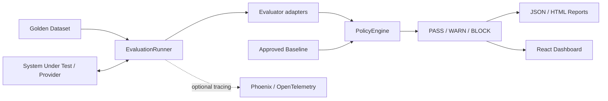

# AI Quality Gate
 
## What is AI Quality Gate?
 
AI Quality Gate is an open-source quality framework that checks whether a software release
is ready to ship. It works with the tests a team already has. It reads the results of
pytest, Vitest and Playwright test runs, checks them against the team's own quality rules,
and compares them with the last release the team approved. It runs in continuous
integration (CI), on every pull request, as one GitHub Action step.
 
It also covers AI features. A built-in evaluation server tests the answers of LLM and RAG
applications built on **OpenAI** and **Gemini** models against curated test datasets, using
RAGAS, DeepEval and OpenAI graders.
 
## Why it matters for companies
 
Most teams decide a release is ready because "all tests passed". That hides a lot: a test
suite that quietly ran fewer tests, a key user flow that was skipped, a test deleted in a
refactor, a flaky test that only passed on its second try. Each of these lets a broken
release reach users with a green build. AI features add another gap: an AI answer can
change between releases without any test failing.
 
AI Quality Gate closes these gaps. Every release gets an explicit, written quality check
that the whole team can read, review and trust.
 
## What you get
 
- **Works with what you have.** pytest, Vitest and Playwright today, through the JUnit XML
  they already write. No test rewrites and no new test runner.
- **Quality rules as code.** Required flows, skips, errors and thresholds live in a reviewed
  `quality-gate.yml`, so every pull request and every repository is held to the same rules.
- **Green means complete.** Missing, empty, truncated or short test results stop the
  release instead of passing silently.
- **Regressions you can see.** Each run is compared with an approved release, not just the
  previous run, and new failures, removed tests and renames are listed by name.
- **An audit trail.** Approved releases are signed off by a named person in a pull request,
  and every check keeps a full report: useful for code review, release sign-off and
  regulated environments.
- **Light and safe to adopt.** The test-suite gate needs three small Python packages and no
  server, database, AI model or secrets.
- **One approach for conventional and AI features.** Check a web app through its test suite,
  and check LLM and RAG quality through the evaluation server and its OpenAI and Gemini
  providers.
## Coming next: StepLab
 
[StepLab](https://steplab.dev) ([source](https://github.com/sdkdeepa/steplab)), an
open-source, Codelab-style tutorial app and editor extension, will be the first project to
run on AI Quality Gate. Its Playwright tests for the three key flows (create a lab and
download the HTML, upload Markdown and reopen it, convert a CLaaT codelab) and its Vitest
unit tests will be checked on every pull request, against an approved baseline, as a
required check. The gate works behind the scenes in StepLab's CI: the app, the extension
and what StepLab's users see stay exactly as they are, with no AI added.
 
## How it works
 
Every check ends in a **release decision**: **PASS** (ready to ship), **WARN** (ship, but
look at the warnings) or **BLOCK** (don't ship), with the reasons. The decision comes from
three things:
 
- **Evidence:** the test results (or, for AI features, the evaluation results).
- **Policy:** the team's quality rules, kept in the repository.
- **Baseline:** the last release the team approved, to spot regressions.
The repository holds two parts that share this approach:
 
| | **`aqg`: quality gate for test suites** | **LLM and RAG evaluation server** |
|---|---|---|
| Evidence | JUnit XML from **pytest, Vitest and Playwright** | Golden datasets scored by deterministic checks, RAGAS, DeepEval and OpenAI graders |
| Runs as | A command-line tool and a GitHub Action | A FastAPI service with a React dashboard |
| Needs | Python and three small packages (pydantic, jsonschema, PyYAML) | The `server` extra; AI providers are optional |
| AI involved | None | Model-based evaluators are opt-in |
| Status | Released as v1.0.0 | Engineering reference project, not a production-deployed service |
 
## Quality gate for test suites (`aqg`)
 
`aqg` is the part a project adds to its CI. Beyond "did any test fail?", it checks
whether the evidence is complete and whether anything got worse since the last approved
release:
 
- **Missing evidence never passes.** A missing, empty, truncated or malformed result file,
  a run where nothing ran, or fewer tests than expected is an error or BLOCK, never PASS.
- **Required tests.** Name the tests that must run and pass (exact ids or `*` patterns).
  A required test that is missing, skipped or erroring blocks the release.
- **Skips and errors are explicit.** Every check is passed, failed, skipped or error;
  skipped and errored checks never count as passed.
- **Approved baselines.** Compare each run with a PASS run you approved and committed. New
  failures, new failing tests, removed tests, required tests now skipped, renames, recovered
  and added tests are each listed separately.
- **Readable results.** `report.json` with every detail, and a `summary.md` that the GitHub
  Action also shows on the run's summary page.
### Supported test frameworks
 
Any runner that writes JUnit XML works; these three are tested against their real output.
 
| Framework | How to write JUnit XML |
|---|---|
| **pytest** | `pytest --junitxml=reports/pytest.xml` |
| **Vitest** | in `vitest.config.ts`: `test: { reporters: ["default", "junit"], outputFile: { junit: "reports/vitest.xml" } }` |
| **Playwright** | in `playwright.config.ts`: `reporter: [["list"], ["junit", { outputFile: "reports/playwright.xml" }]]` |
 
The tool that wrote a file is detected automatically; set `source:` on an input if it
can't be. If the same Playwright tests run in several projects (browsers), add
`includeProjectInTestName: true` to the JUnit reporter so each project's tests get their
own ids.
 
### Quick start
 
1. Add `quality-gate.yml` to your repository:
```yaml
version: 1
project: my-app
inputs:
  - type: junit
    path: reports/vitest.xml        # a path or a glob, relative to this file
    suite: unit                     # label that starts every check id
  - type: junit
    path: reports/playwright.xml
    suite: e2e
    min_checks: 3                   # BLOCK if fewer tests than this are found
policy:
  required: ["e2e::*export*"]       # must run and pass
```
 
   Every setting, with its default, is listed in [backend/aqg/config.py](backend/aqg/config.py).
   Unknown keys are errors, so a typo can't silently switch a rule off.
 
2. Run your tests, then the gate:
```bash
aqg validate        # check quality-gate.yml only
aqg check           # decide; writes aqg-report/report.json and summary.md
```
 
   In GitHub Actions, use the action instead (see [Use it in GitHub Actions](#use-it-in-github-actions)).
 
### What decides the outcome
 
| Outcome of a check | Required check | Other checks |
|---|---|---|
| passed | fine | fine |
| passed only after a retry (flaky) | WARN | WARN |
| failed | BLOCK | BLOCK |
| error (crash, setup failure, timeout) | BLOCK | BLOCK |
| skipped | BLOCK | WARN |
| missing (a required id or pattern matched nothing) | BLOCK | – |
 
These are the defaults; each can be set to `block`, `warn` or `ignore` under `policy:`,
and `min_pass_rate` adds a pass-rate floor. Two rules can't be switched off: a run with no
checks, or where nothing passed or failed, is always BLOCK. WARN doesn't fail CI unless
`fail_on_warn: true`.
 
`aqg check` exit codes: **0** PASS (or WARN), **1** BLOCK (or WARN with `fail_on_warn`),
**2** config error, **3** input error (missing or broken result files).
 
### Baselines
 
```bash
aqg check
aqg baseline approve --report aqg-report/report.json --approved-by <your name>
```
 
Only a PASS run can be approved (a WARN run with `--allow-warn`). Commit the baseline file
(for example `quality/baseline.json`) in a reviewed pull request, then point the config at it:
 
```yaml
baseline:
  path: quality/baseline.json
  renames:                             # optional: compare a renamed test as one test
    "e2e::export.spec.ts::old name": "e2e::export.spec.ts::new name"
```
 
By default new failures, new failing tests, required tests now skipped and removed required
tests block; other removed tests and possible renames warn (`policy.regressions`).
 
### Known limits
 
- Flaky tests are detected from pytest reports (with pytest-rerunfailures). Vitest's and
  Playwright's JUnit output only records the final attempt, so a test that passed on retry
  shows as passed there.
- JUnit XML only for now; the result files are read, the test runners aren't changed.
## LLM and RAG evaluation server
 
### What it does
 
The Quality Gate separates **evaluation signals** from **release policy**. RAGAS, DeepEval, OpenAI-model graders, and deterministic checks produce normalized `MetricResult`s. The platform-owned `PolicyEngine` decides whether a run can ship.
 
Core capabilities:
 
- Versioned golden datasets with critical cases
- Deterministic checks for exact/phrase/schema/refusal/citation/latency/cost behavior
- OpenAI and Gemini providers behind a provider-neutral interface
- Sample LangChain + Chroma RAG workload used as a system under test
- RAGAS, DeepEval, and OpenAI-model graders behind evaluator adapters
- Baselines, regression detection, latency/cost budgets, and PASS/WARN/BLOCK policy
- Optional Phoenix/OpenTelemetry tracing
- JSON/HTML reports and a React engineering dashboard
- Deterministic GitHub Actions CI, optional live-provider workflow, and Docker packaging
- Request limits, redacted logging, bounded retries, evaluator timeouts, readiness checks, and a basic write-auth boundary
### Architecture
 

 
The important boundary is deliberate: **frameworks provide signals; the Quality Gate owns release policy.** Phoenix observes execution but never participates in the decision.
 
See [ARCHITECTURE.md](ARCHITECTURE.md) for component, evaluation-pipeline, and decision-flow diagrams.
 
### Evaluation model
 
A run loads a named/versioned golden dataset, sends each case through a provider, and applies the evaluators that are relevant to that case. Evaluator outputs are normalized into the same internal model regardless of framework. Infrastructure failures are represented separately from quality failures, so a rate limit or judge timeout is not treated as a bad model answer.
 
The policy engine then evaluates pass rate, required metrics, critical cases, baseline regressions, latency/cost budgets, and evaluator availability. A run with no scored metrics cannot pass.
 
See [EVALUATION_STRATEGY.md](EVALUATION_STRATEGY.md) for the framework and policy rationale.
 
## Repository structure
 
```text
ai-quality-gate/
├── README.md
├── ARCHITECTURE.md
├── EVALUATION_STRATEGY.md
├── SECURITY.md
├── PROJECT_STATE.md
├── DECISIONS.md
├── docker-compose.yml
├── .github/workflows/       # deterministic PR CI + manual live evaluation
├── docs/                    # CI/CD and Phoenix debugging guides
├── scripts/smoke_test.sh
├── frontend/                # React + TypeScript dashboard
└── backend/
    ├── aqg/                 # the quality-gate core and aqg CLI (no server needed)
    └── app/                 # the API server
        ├── domain/
        ├── providers/
        ├── evaluation/
        ├── rag/
        ├── policy/
        ├── reports/
        ├── observability/
        ├── reliability/
        ├── repositories/
        ├── services/
        ├── api/
        └── core/
```
 
## Install
 
The package installs in two ways. The **core** is the `aqg` command-line gate: it reads
JUnit XML from pytest, Vitest and Playwright and decides PASS, WARN or BLOCK, with only
pydantic, jsonschema and PyYAML as dependencies. The **server** (the API, dashboard
backend, RAG demo and model-based evaluators) is an optional extra.
 
```bash
# The aqg CLI only. The package lives in backend/, hence #subdirectory.
# Pin a release tag (or a commit SHA) rather than a branch.
pip install "ai-quality-gate @ git+https://github.com/sdkdeepa/ai-quality-gate@v1.0.0#subdirectory=backend"
 
# The server too
pip install "ai-quality-gate[server] @ git+https://github.com/sdkdeepa/ai-quality-gate@v1.0.0#subdirectory=backend"
```
 
| Extra | Adds |
|---|---|
| (none) | the `aqg` CLI: pydantic, jsonschema, PyYAML |
| `server` | everything the API server needs to start: FastAPI, uvicorn, pydantic-settings, LangChain and Chroma (RAG demo), the OpenAI and Gemini SDKs, OpenTelemetry/Phoenix tracing |
| `ragas` | RAGAS judge metrics (includes `server`) |
| `deepeval` | DeepEval judge metrics (includes `server`) |
| `all` | all of the above |
 
Importing the server without its extra fails with a message naming the extra to
install. In a checkout, `uv sync` still installs everything (the dev group includes
`all`); `uv sync --no-dev` installs the core only. See [CHANGELOG.md](CHANGELOG.md).
 
## Use it in GitHub Actions
 
Add a `quality-gate.yml` to your repository (see [backend/aqg/config.py](backend/aqg/config.py)
for every setting), make your test runners write JUnit XML, and add a step after your tests:
 
```yaml
- name: Quality gate
  if: ${{ !cancelled() }}            # decide even when a test step failed
  uses: sdkdeepa/ai-quality-gate@v1
  with:
    config: quality-gate.yml         # the default
```
 
To pin an exact version, use the full commit SHA of a release instead of the tag:
 
```yaml
  uses: sdkdeepa/ai-quality-gate@<40-character commit sha> # v1.0.0
```
 
The action installs the `aqg` core from its own version (no server, database or AI model),
runs `aqg check`, uploads `report.json` and `summary.md` as a workflow artifact, writes the
run summary, and fails the step on BLOCK, on WARN when `fail_on_warn` is on, or on a config
or input error. It runs on Linux and macOS runners. Inputs: `config`, `working-directory`,
`version`, `commit`, `output`, `upload-report`, `artifact-name` (must be unique in a run),
`python-version`. Outputs: `decision`, `exit-code`, `report-dir`. This repository's own pull
requests are checked by this action (see `quality-gate.yml` at the root).
 
## Run locally
 
With Docker:
 
```bash
cp .env.example .env
docker compose up --build
```
 
Backend: `http://localhost:8000`  
Dashboard: `http://localhost:5173`
 
To stop: `docker compose down` (Ctrl+C alone, or closing the terminal, often
leaves the containers running in the background).
 
Evaluation runs are in-memory and reset with the backend process — useful
when testing locally and you want a clean slate. Restarting just the
backend is faster than a full teardown:
 
```bash
docker compose restart backend
```
 
If you do want a full stop/start cycle (e.g. to also pick up a code change
in `docker-compose.yml` or a Dockerfile):
 
```bash
docker compose down
docker compose up --build
```
 
Without Docker:
 
```bash
cd backend
uv sync
uv run uvicorn app.main:app --reload
uv run pytest -v
uv run ruff check .
```
 
```bash
cd frontend
npm install
npm run dev
npm test
npm run build
```
 
All supported environment variables and safe defaults are documented in [.env.example](.env.example). Real providers, model-based evaluators, authentication, and Phoenix tracing are opt-in.
 
## Sample evaluation
 
```bash
curl -X POST http://localhost:8000/api/v1/evaluations/runs \
  -H "Content-Type: application/json" \
  -d '{"dataset_name":"customer_support_bot","dataset_version":"1.1.0"}'
```
 
The bundled deterministic dataset contains 40 cases. Its fixture run intentionally includes failures so the gate can demonstrate critical-case and release-policy behavior. Run the gate with the returned run id:
 
```bash
curl -X POST http://localhost:8000/api/v1/gate/decisions \
  -H "Content-Type: application/json" \
  -d '{"run_id":"<run-id>"}'
```
 
A decision can be exported as JSON or HTML through `/api/v1/reports/{decision_id}/json` and `/html`.
 

 
## Testing and CI
 
The backend uses PyTest; the frontend uses Vitest and React Testing Library. `aqg` has its own tests, run against real JUnit output from pytest, Vitest and Playwright, and checks this repository's own pull requests. Tests cover domain validation, datasets, provider contracts, evaluator adapters, RAG, policy decisions, reports, observability boundaries, API behavior, security/reliability paths, and the dashboard.
 
Every PR runs deterministic checks without paid model calls: lint/format, backend tests, API/integration tests, backward-compatibility tests, packaging checks (a core-only install, a full install, and an install from GitHub at the PR's commit), frontend tests, an end-to-end smoke test against a running service, Docker build validation, the quality gate on its own test results, a test of the GitHub Action, coverage, and dependency scans. The checks run once per pull request, not again after merging. A separate manual workflow can run a controlled live-provider evaluation using repository secrets and uploads reports as artifacts. See [docs/ci-cd.md](docs/ci-cd.md).
 
## Observability
 
When enabled, OpenTelemetry traces expose the run as nested spans for cases, provider calls, RAG retrieval/generation, and evaluator execution. Trace IDs are correlated with run and gate records. If Phoenix is unavailable, tracing degrades without changing release behavior. See [docs/debugging-failed-runs.md](docs/debugging-failed-runs.md).
 
## Production gaps and trade-offs
 
The project intentionally stops short of claiming production deployment. Current limitations include:
 
- Datasets, evaluation runs, and case results are in memory; policies, baselines, and gate decisions use SQLite.
- Write access can be protected by one shared API key, not per-user RBAC.
- TLS termination, rate limiting, and a production identity/audit system are outside this repository.
- Request-size enforcement relies on `Content-Length`, so chunked transfer is a known gap.
- Evaluator timeouts stop the caller from waiting but cannot forcibly kill an already-running Python thread.
- Evaluation is synchronous; higher scale would require durable storage, async job execution, connection pooling, and horizontal scaling.
See [SECURITY.md](SECURITY.md) for the security boundary and [DECISIONS.md](DECISIONS.md) for the major architectural trade-offs.
 
## Documentation
 
- [ARCHITECTURE.md](ARCHITECTURE.md) — system design, data flow, decision flow, technology choices
- [EVALUATION_STRATEGY.md](EVALUATION_STRATEGY.md) — evaluator responsibilities, failure semantics, baselines, release policy
- [SECURITY.md](SECURITY.md) — implemented controls and known limitations
- [docs/ci-cd.md](docs/ci-cd.md) — deterministic and live CI workflows
- [docs/debugging-failed-runs.md](docs/debugging-failed-runs.md) — trace-based debugging
- [PROJECT_STATE.md](PROJECT_STATE.md) — concise current-state handoff
- [DECISIONS.md](DECISIONS.md) — architectural decision record
- [CHANGELOG.md](CHANGELOG.md) — releases and notable changes
## License
MIT. See [LICENSE](LICENSE).
 